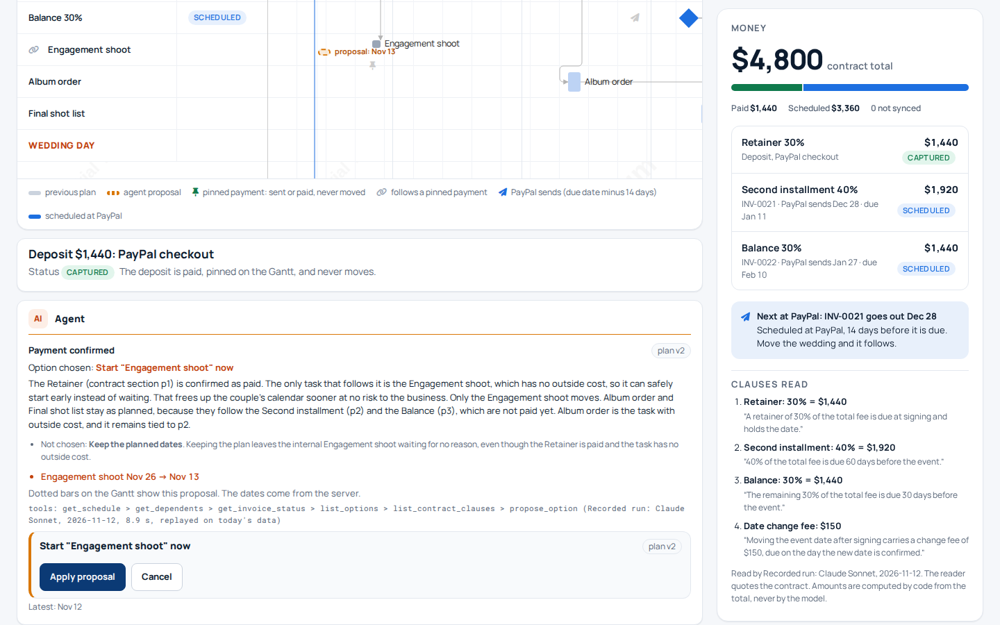
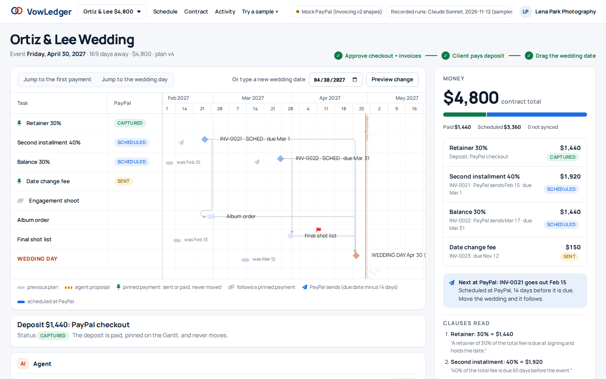

# VowLedger

**Try it:** https://vowledger.35-216-2-121.sslip.io (hosted demo: mock PayPal, recorded Claude Sonnet runs; no login).

> **Summary.** VowLedger is a Bryntum Gantt where dragging a wedding date rewrites the real scheduled PayPal invoices to match.
> An agent reads payment rules from the signed contract; the server computes every date and amount, and a human approves each PayPal write.
> PayPal events flow back too: a paid or overdue invoice makes the agent propose a schedule change, drawn as a second baseline.




**Drag the wedding date on a Bryntum Gantt and VowLedger rewrites the couple's real scheduled PayPal invoices to match, using payment rules an agent read from the signed contract.**

A wedding photographer uploads a signed contract. An agent reads the payment clauses ("40% due 60 days before the event") and the server counts every date back from the wedding day. The first milestone (the deposit) is collected through a PayPal Orders checkout link, and the later milestones become PayPal Invoicing v2 invoices that are scheduled to be sent 14 days before each due date. When the couple moves the date, the photographer drags one bar on the Gantt. Unsent payments and production tasks follow, paid or sent payments stay pinned, and one approval rewrites the issue date and due date of every scheduled invoice.

Who it is for: a solo wedding photographer who takes a deposit at signing and bills the rest of the fee through PayPal in installments counted back from the wedding day. The problem, its sources, the PayPal-side numbers and the business model are in `../DEVPOST.md`.

Most Gantt ideas for PayPal go one way: PayPal events move the schedule. VowLedger goes both ways. A payment event makes an agent propose a schedule change (drawn as a second baseline), and a human edit of the Gantt becomes a PayPal write.

## Why a Gantt

The problem is a set of dates hanging off one date. A table or a calendar cannot show "move the wedding and everything counted back from it moves, except what is already sent". The app uses Bryntum Gantt (trial build, installed from public npm) for:

- a **Backward** (ALAP) project: the wedding day is the anchor, payments and tasks are counted back from it
- milestones for payments, FS dependencies with lags, and constraints (`muststarton` for pinned items, `startnolaterthan` for the wedding day, `startnoearlierthan` for held tasks)
- **up to two baselines per bar** (previous plan, agent proposal): baseline 0 is the plan before the last change (grey, labelled "was Nov 26"), baseline 1 is the agent's proposal (orange dashed, labelled "proposal: Nov 13"), drawn by a baseline renderer
- the **Indicators** feature: a paper-plane marker at each invoice's issue date (due date minus 14 days), and the album order's `deadlineDate`
- the **TimeRanges** feature: a band for today and one for the wedding day
- a fixed scale of 6 px per day with a week and month header, so baselines stay visible; the panel scrolls to the wedding day and to whatever just changed
- drag of the wedding bar with a live preview on Bryntum's own scheduling engine, and drag of a scheduled payment later to draft an extension (a second Gantt edit that becomes a PayPal `PUT`)

Confirmed dates come from the server engine, not from Bryntum, because PayPal webhooks must be handled while no browser is open. `npm run check:bryntum` drives the real Gantt in headless Chromium and checks that Bryntum's preview equals the server's plan (7 checks including the proposal baseline position and the issue-date indicators, see `VERIFY.md`).

## How the pieces fit

```
React 19 + Vite  (draws only)
  BryntumGantt  Backward project, pinned milestones, baselines 0 and 1, PayPal badges
Express 5  (the only source of dates, amounts and PayPal calls)
  schedule/engine.js      pure date engine: wedding offsets, issue date = due - 14 days, FS + lag, pins, holds
  schedule/options.js     builds the choices for an event and computes the schedule each one leads to
  schedule/diffPaypal.js  schedule -> list of PayPal changes (pinned invoices never appear)
  agent/                  Claude tool loop (or the rule-based twin): read tools + propose_option only
  services/approvals.js   the only code that changes PayPal, behind approval cards and a per-contract lock
  integrations/           PayPal Invoicing v2: sandbox (REST + Agent Toolkit) or mock with identical shapes
  integrations/orders/    PayPal Orders v2 for the deposit: APIMatic SDK adapter or a mock with the SDK's Order shape
  services/deposits.js    deposit checkout: claim, create order, capture on return, unknown-outcome settling
```

**Rules the code enforces**

- The model never writes a date or an amount. Dollar amounts are `round(total * percent / 100)` in code and must add up to the contract total. Dates come from the engine. The model gets read tools plus `propose_option(option_id, reason, not_chosen)`; an id that is not in the server list, an option left without a `not_chosen` reason, or any date or dollar amount in the text, is rejected.
- Nothing reaches PayPal without an approval card: create invoices, apply a wedding date move, apply an agent proposal, send a reminder, record a bank transfer. A card runs once (claimed before any await), only on the plan version it was drawn on ("Plan changed, recalculate" otherwise), and under a lock per contract.
- The deposit is an Orders checkout, not an invoice. The server creates the order for the exact scheduled amount, the client approves it on PayPal, and on return the server reads the order, checks the amount against the schedule, and captures. A claim row is stored before each PayPal write; a lost answer is settled by a read-back or a replay with the same `PayPal-Request-Id`, never reported as failed. A captured deposit is pinned and paid on the Gantt, so a wedding move lists it under Unchanged and the agent cannot move it.
- Invoices that are sent, unpaid or paid are pinned: the engine does not move them and the approval card lists them under "Unchanged (pinned)". Moving the wedding earlier than a pinned payment allows is refused by the server.
- Invoice creation uses `PayPal-Request-Id` (`contractId:stepId:version`). Webhook events are de-duplicated by event id, and every event is only a hint: the status always comes from `get_invoice`.
- A PayPal failure in the middle of a reschedule keeps the successes, shows "2 of 3 changes applied", marks the failed invoice "not synced", and retries only that invoice.

**Date rules** (T = the day the sample is opened, shown for T = 2026-11-12)

| | Event | Retainer / deposit (signing) | 2nd installment (60 days before) | Balance (30 days before) |
|---|---|---|---|---|
| Sample A, Kim & Rivera | T+60 = 2027-01-11 | checkout link at signing (Orders) | send 11-12 (rule date is in the past), due 11-12 | send 11-28, due 12-12, SCHEDULED |
| Sample B, Ortiz & Lee | T+120 = 2027-03-12 | checkout link at signing (Orders) | send 12-28, due 2027-01-11, SCHEDULED | send 2027-01-27, due 02-10, SCHEDULED |
| B after moving to 2027-04-30 | +49 days | pinned | send 02-15, due 03-01 | send 03-17, due 03-31 |

With `DEPOSIT_CHECKOUT=0` the first milestone is an invoice sent and due on 11-12. Issue date = due date - 14 days, never earlier than today. A contract clause such as "invoices are sent 7 days before each due date" replaces the 14. `test/engine.test.js` reproduces every date in this table.

## Run it

Node 20 or newer.

```bash
npm install
cp .env.example .env      # optional: keys are not needed
npm run build
npm start                 # http://localhost:3002
```

Recording state for the video: `npm run demo:video` (builds, forces mock PayPal and the model replay, fresh state). Development: `npm run dev` (server on 3002, Vite on 5174). Tests: `npm test` (forces mocks). Gantt check: start the app with `FORCE_MOCK=1 npm start`, then `npm run check:bryntum` (needs a Playwright Chromium; it waits on server answers and Gantt state, not on fixed sleeps). README screenshots: `docs/img/README-shots.md` lists which screen each image shows and the command that regenerates them.

Without keys the app runs on a **mock PayPal** that returns Invoicing v2 shapes and statuses (DRAFT, SCHEDULED, SENT, PARTIALLY_PAID, MARKED_AS_PAID, PAID), an Orders mock in the SDK's `Order` shape (CREATED, APPROVED, COMPLETED) and a stand-in checkout page at `/mock-paypal/checkout` and on **recorded Claude runs**: for the three sample contracts, the contract reading and every agent decision of the demo path replay a real Claude Sonnet run recorded on 2026-11-12 (`server/builtin/recorded-runs/`, made with `npm run record:runs` through a local Claude Code login). A replay calls today's tools in the model's recorded order and submits the model's recorded pick through the same validation, and the screen says "Recorded run: Claude Sonnet, 2026-11-12". Text you paste yourself, or an event with no recording, goes to a **rule-based agent** that calls the same tools and is labelled "Rule-based agent". With sandbox keys, the deposit order calls use the APIMatic SDK, invoice create and PUT use REST, and send, get, delete, reminder and record payment use the PayPal Agent Toolkit. No call in the test suite reaches PayPal or Anthropic.

### Environment

| Variable | Needed for | Default |
|---|---|---|
| `PAYPAL_CLIENT_ID`, `PAYPAL_CLIENT_SECRET` | PayPal sandbox instead of the mock | empty (mock) |
| `PAYPAL_WEBHOOK_ID` | verifying sandbox webhook signatures | empty |
| `ANTHROPIC_API_KEY`, `ANTHROPIC_MODEL` | Claude reads contracts and picks options | empty (rule-based), `claude-sonnet-5-5` |
| `POLL_INTERVAL_MS` | invoice polling (second entrance, and the only one if a webhook cannot reach localhost) | 5000 |
| `SANDBOX_BUYER_EMAIL`, `SANDBOX_BUYER_PASSWORD` | shown to judges in the demo controls | empty |
| `DEPOSIT_CHECKOUT` | `0` collects the first milestone by invoice instead of an Orders checkout | 1 |
| `APP_BASE_URL` | public URL PayPal returns the payer to (`/api/deposit/return`) and where the mock checkout page lives | `http://localhost:PORT` |
| `LLM_BACKEND` | `account` runs Claude through your own Claude Code login (local development only, never an API key); the UI then says "Claude Sonnet (local account)" | empty |
| `FORCE_MOCK` | `1` ignores all keys and the account backend | 0 |
| `FORCE_MOCK_PAYPAL` | `1` keeps PayPal on the mock while the model runs | 0 |
| `PORT` | server port | 3002 |

## Testing instructions

Step 2 to 4 are the three steps of the guide band at the top of the app.

1. **Try sample: Ortiz & Lee.** Open the app and press **Try sample: Ortiz & Lee**. The reader quotes three clauses, the server checks that 30% + 40% + 30% = $4,800, and a card asks to create the deposit checkout and 2 PayPal invoices.
2. **Approve checkout + invoices.** Press "Approve checkout and 2 invoices". The deposit ($1,440) becomes a PayPal Orders checkout (badge `ORDER CREATED`, pinned on the Gantt) and the other two milestones show SCHEDULED invoices with send and due dates.
3. **Client pays deposit.** Press "Open the client checkout link" under the Gantt, then "Pay Now" on the checkout page (mock page without keys, PayPal sandbox with keys). The link opens a new tab; PayPal returns the payer to the app in that tab, the server captures the order (the first tab refreshes within 4 seconds), the badge turns `CAPTURED`, the agent calls its tools and picks a server-computed option, and a dotted proposal appears on the Gantt. Press "Apply proposal". ("Record bank transfer" and "Sandbox buyer pays" in Demo controls work on the invoices.)
4. **Drag the wedding date.** Use "Jump to the wedding day" above the Gantt, then drag the red diamond on the WEDDING DAY row about 49 days to the right, or type the date 49 days later in the date box above the Gantt (2027-04-30 when the sample is opened on 2026-11-12) and press "Preview change". The unsent payments and tasks follow, the old plan stays as a grey baseline, and the right rail turns into the approval panel: each invoice with its send and due date before and after (`Dec 28 -> Feb 15`), the new date change fee, the captured deposit under "Unchanged (pinned)", who approves, and the PayPal calls that run. Press "Approve 3 PayPal changes"; badges turn "synced" and the Money rail says "0 not synced". Optionally drag a SCHEDULED payment diamond later: a card such as "Extend INV-0022 due Feb 10 -> Feb 24?" drafts one `PUT`, and an order violation is refused.
5. **Other samples and a failure.** Open **Try a sample** in the top bar and pick **Kim & Rivera** (the 2nd installment is due today and unpaid: the agent holds the outside-cost album order until PayPal reports that invoice PAID, the Gantt row says "waits for INV-...", and drafts a reminder), **Novak & Daniels** (clauses add up to $4,560, the contract check blocks invoicing), and a partial failure: open **Ortiz & Lee** again, approve, open "Demo controls (mock PayPal)", press "Make the next PayPal edit fail", then do step 4 (the screen says "2 of 3 changes applied"; Retry sends only the failed invoice).

You can also paste your own made-up contract text. Use no real personal data.

## AI use

Claude (`claude-sonnet-5-5`, tool use) does two jobs when a key is set, or when `LLM_BACKEND=account` runs it through a local Claude Code login (verified this way on 2026-11-12, see `VERIFY.md` V8; the hosted API-key path is implemented and unit-tested with the same validation but was not run). Without either, the sample contracts replay the real runs recorded on 2026-11-12 (6 runs: 3 readings, 3 agent decisions, each with its tool calls in order, the model's closing text and timings) and say so on screen; anything else uses a rule-based twin labelled "Rule-based agent". The agent is not one forced call: in the recorded runs it called 3 to 5 read tools in its own order (for example `get_schedule > get_invoice_status > get_dependents > list_contract_clauses > list_options > propose_option`) before picking. It reads contract text into clauses with exact quotes; each quote must exist in the text and each percent must appear in its quote, or the reading is refused. And it chooses among options the server computed (start a task early, hold an outside-cost task, add or waive the date-change fee) and explains why, plus one reason for every option it did not pick (`not_chosen`). The server refuses a proposal that skips an option, names one twice, or puts a date or a dollar amount in any of that text, and a reminder must cite the contract clause it rests on (`reminder_clause`, checked against the contract). The screen shows each "Not chosen" line under the agent's reason. It cannot create, change or send anything. Claude Code (Sonnet) was used to write the code.

## PayPal use

- Orders v2 through the APIMatic SDK (deposit): `POST /v2/checkout/orders` (intent `CAPTURE`, `PAY_NOW`, `NO_SHIPPING`, return and cancel URLs), `GET /v2/checkout/orders/{id}`, `POST /v2/checkout/orders/{id}/capture`, each with its own `PayPal-Request-Id`
- Invoicing v2 REST: `POST /v2/invoicing/invoices` with `detail.invoice_date`, `payment_term.term_type = DUE_ON_DATE_SPECIFIED` and `due_date`, `configuration.partial_payment`; `PUT /v2/invoicing/invoices/{id}` rewriting issue and due dates (the body is the invoice just read with `get_invoice`, because PUT replaces everything omitted)
- PayPal Agent Toolkit 1.11.0: `send_invoice` (a future issue date means PayPal schedules it; verified in the sandbox, V1), `get_invoice`, `delete_invoice`, `send_invoice_reminder`, `record_payment_for_invoice`
- Polling (used in the demo) plus a webhook route with signature verification and event de-duplication (not exercised against the sandbox)
- Why REST for create and PUT: Toolkit `create_invoice` has no due date field, and `update_invoicing` would clear `payment_term`. Also found in the sandbox: `send_invoice` hides a 422 `USER_NOT_FOUND` and leaves the invoice in DRAFT. Both are gaps worth fixing in the Toolkit.

## Built with the APIMatic Context Plugin

The APIMatic Context Plugin for PayPal (0.4.1) was applied with its skills `typescript-integrate-paypal`, `typescript-getting-started`, `typescript-error-handling`, `typescript-client-initialization`, `typescript-calling-endpoints`, `typescript-models`, `typescript-configuration-resilience` and `typescript-testing`. The generated SDK (package `paypal`, client `PaypalClient`, version 2.29.0) is installed from a commit-pinned `git+https://github.com/context-plugins/paypal-typescript-sdk#5d0df8a8817e5fdf2e2cd48e68f790ea4730aab2`.

**Through the SDK (the deposit, Orders v2):** `orders.createOrder`, `orders.getOrder`, `orders.captureOrder`, in `server/integrations/orders/liveOrders.js`. The client is built once, bound to the sandbox host, with logging off and no SDK retry on writes. Each durable write has a claim stored before the call, a `PayPal-Request-Id`, a read-back or same-id replay after a lost answer, and a mapping from the SDK's error family to HTTP statuses. `test/orders.test.js` runs the real SDK over a faked `fetch` (22 tests, no network).

**Not in the SDK, kept on REST or the Agent Toolkit:** every Invoicing v2 call (create, PUT, send, get, delete, reminder, record payment) and webhook signature verification, because the SDK map has neither. A refund (`payments.refundCapturedPayment`) is planned in `paypal-plan.md` but not wired: a captured deposit is pinned and never moved or cancelled by this app.

The full contract sheet is `paypal-plan.md`.

### Sandbox demo mode

Put a sandbox REST app's `PAYPAL_CLIENT_ID` and `PAYPAL_CLIENT_SECRET` in `.env` and run `npm run demo:sandbox`. It builds the client and starts the server with `FORCE_MOCK=0`, and refuses to start if the keys are missing, so a mock is never shown by mistake. The header chip says "PayPal sandbox connected" (the mock says "Mock PayPal (Invoicing v2 shapes)"). In this mode "Open the client checkout link" opens the real PayPal sandbox checkout, invoices are real sandbox invoices, the mock checkout page and the mock-only demo buttons are off, and the controls panel is titled "Payments and polling". Set `APP_BASE_URL` to the public URL when the app is hosted, so PayPal returns the payer to it. `scripts/sandbox-walk.py` drives README steps 1 to 4 in this mode as a sandbox buyer, and `node scripts/sandbox-invoices.mjs list` lists the account's invoices (sandbox host only, secrets never printed).

### Sandbox results (2026-11-12)

The same list is in the app under **Sandbox evidence** (bottom of the page). Only PASS rows are claimed.

| Item | Result |
|---|---|
| V1 | PASS: two SCHEDULED invoices stayed SCHEDULED after `PUT` moved issue and due dates |
| V2 | PASS: a past due date is accepted |
| V4 | PASS: `PUT` on a SENT invoice is allowed (the app uses it only for the scheduled-payment extension, not for sent ones) |
| V7 | PASS: SDK smoke, a real `getOrder` answered 404 with the mapped message |
| V9 | PASS (steps 1 to 5): deposit order created, approved by the sandbox buyer and captured once ($1,440.00 COMPLETED); a second capture press sent no call |
| S1 | PASS: the whole README path (steps 1 to 4) in sandbox mode (`npm run demo:sandbox`). Deposit order `28E9422366600420M` paid by the sandbox buyer on the real PayPal sandbox checkout page, capture `98690159WF131234R` ($1,440.00 COMPLETED). Wedding moved Mar 12 -> Apr 30 and approved: `get_invoice` shows INV-0021 (`INV2-86XB-BSRM-ZLFH-YTEF`) SCHEDULED send 2027-02-15 / due 2027-03-01 and INV-0022 (`INV2-D2M6-NSD4-4X6K-GC8S`) SCHEDULED send 2027-03-17 / due 2027-03-31; fee invoice INV-0027 (`INV2-N9E9-SLEG-4XZU-4HTH`) SENT. Numbers INV-0023 to INV-0026 were already taken on the shared sandbox account and were skipped automatically |
| V3 | partial: record-payment partial path PASS, hosted-page partial payment not driven |
| V8 | PASS in account mode (Claude Sonnet through a local Claude Code login, not the hosted API) |
| VB1-VB7 | PASS: the real Bryntum Gantt in headless Chromium agrees with the server engine (`npm run check:bryntum`) |
| V5 webhooks, V6 auto reminders, V9 step 6 (network cut) | not run |

## Bryntum trial notes

`@bryntum/gantt` is installed as an npm alias of `@bryntum/gantt-trial` (see `package.json`). The trial shows a watermark, which is kept. No Bryntum file is committed. The trial license is for evaluation, so a public host should be agreed with Bryntum first; this repository is meant to be run locally, and the submission video shows the full flow.

## Not included

Customer portal, e-signature, multi-currency, tax, multi-user login, long-term contract storage and scanned or PDF contracts (contracts are read as text). The wedding planner view across several vendors is the next step: each vendor keeps their own PayPal account and schedule, and the planner view only reads them.

## License

MIT for this source (see `LICENSE`). Bryntum is under its own license.
